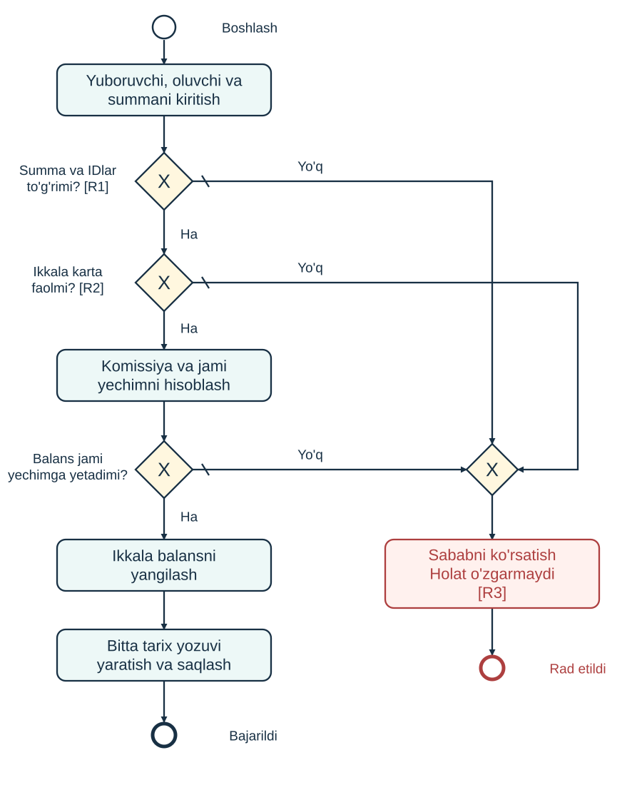

# CARDLAB - KARTALAR BILAN AMALIYOTLAR

**Biznes talablar (BT) va amaliy topshiriq | v1.0 | Python**

Daraja: Python asoslarini biladigan maktab o'quvchilari. Tavsiya: 120 daqiqa, jamoada 2-3 kishi. Kerakli bilimlar: funksiya, shart, lug'at, ro'yxat, fayl va sodda klass bilan ishlash.

## 1. Vaziyat va vazifa

CardLab demo hamyonidagi karta amaliyotlari noto'g'ri ishlayapti. Sizga terminalda ishga tushadigan, ichiga ataylab biznes mantiq xatolari kiritilgan Python loyihasi beriladi. BT va BPMN asosida xatolarni toping, sababini aniqlang, tuzating va tekshiring.

Natija: foydalanuvchi balansni ko'ra oladigan, demo hisobni to'ldiradigan, boshqa kartaga pul o'tkazadigan, kartani bloklaydigan va tarixni ko'radigan to'g'ri ishlovchi dastur.

Bu o'quv modeli. Haqiqiy bank integratsiyasi, karta raqami, PIN, ro'yxatdan o'tish, internet, ma'lumotlar bazasi serveri va veb-sahifa talab qilinmaydi. Komissiya va cheklovlar aynan shu topshiriq uchun belgilangan.

## 2. Boshlang'ich ma'lumotlar

| ID | Karta nomi | Balans, so'm | Holat |
|---|---|---:|---|
| C1 | Asosiy karta | 200 000 | FAOL |
| C2 | Jamg'arma | 50 000 | FAOL |
| C3 | Zaxira karta | 100 000 | BLOKLANGAN |

Tarix dastlab bo'sh, keyingi amaliyot IDsi 1. Har bir mustaqil test shu holatdan boshlanadi. Pul qiymatlari butun so'mda saqlanadi. Kartalar bitta demo hamyonga tegishli; autentifikatsiya topshiriqqa kirmaydi.

## 3. Barcha pul amaliyotlari uchun qoidalar

**R1. Summa.** Faqat 1 dan 1 000 000 gacha, ikkala chegara ham kiradi. Kiritma o'nlik sanoqdagi butun son yozuvi bo'lishi kerak: `50000` mumkin; `0`, `-100`, `1.5`, `1000.0`, `1e3`, bo'sh qiymat va matn mumkin emas. Boshidagi va oxiridagi bo'shliqlar olib tashlanadi. `0010` = 10. Balans, summa va komissiya Python `int` turida bo'lsin.

**R2. Karta.** Kiritilgan ID mavjud bo'lishi kerak. Bloklangan kartaning balansini va tarixini ko'rish, uni blokdan chiqarish mumkin. Bloklangan karta pul yubora olmaydi, pul qabul qila olmaydi va uning demo hisobini to'ldirish mumkin emas.

**R3. Rad etish.** Tekshiruv muvaffaqiyatsiz bo'lsa, tushunarli sabab ko'rsatiladi. Hech bir balans, karta holati, tarix, keyingi ID yoki saqlangan ma'lumot o'zgarmaydi. Noto'g'ri foydalanuvchi kiritmasi dasturni yopib yubormasin. Bir nechta xato birga kelsa, istalgan tegishli sababni chiqarish yetarli.

**R4. Saqlash.** Muvaffaqiyatli to'ldirish, o'tkazma va bloklash/blokdan chiqarishdan keyin joriy holat `data/bank.json` fayliga yoziladi. Dastur qayta ochilganda balanslar, holatlar, tarix va keyingi ID tiklanadi. Fayl yo'q bo'lsa, boshlang'ich holat olinadi. Buzilgan JSON, disk nosozligi va bir vaqtda ikki dastur ishlashi bu topshiriq doirasiga kirmaydi.

## 4. Amaliyotlar

### A. Kartalar va balans

Har uch karta uchun ID, nom, balans va holatni ko'rsating. Ko'rish amali ma'lumotni o'zgartirmaydi.

### B. Demo hisobni to'ldirish

Karta IDsi va summa kiritiladi. R1 va R2 tekshiriladi. Faqat tanlangan kartaning balansi summaga oshadi. Komissiya 0. Bitta `TOP_UP` tarix yozuvi yaratiladi va holat saqlanadi. Bu virtual mablag'; boshqa kartadan pul yechilmaydi.

### C. Kartadan kartaga pul o'tkazish

Yuboruvchi ID, qabul qiluvchi ID va summa kiritiladi. R1-R2 bajarilishi, kartalar turlicha bo'lishi va yuboruvchida komissiyani ham qoplaydigan balans bo'lishi shart.

```text
komissiya = summaning 1 foizi, butun so'mgacha yuqoriga yaxlitlanadi
jami yechim = summa + komissiya
yuboruvchining yangi balansi = eski balans - jami yechim
qabul qiluvchining yangi balansi = eski balans + summa
```

Masalan, 50 000 so'm uchun komissiya 500; 50 001 so'm uchun 501; 1 so'm uchun 1. Komissiya qabul qiluvchiga qo'shilmaydi. Komissiya hisobi alohida karta sifatida yuritilmaydi: ikki karta balanslari yig'indisi faqat komissiya miqdoriga kamayadi.

Yuboruvchining balansi jami yechimga aynan teng bo'lsa, amaliyot bajariladi va balans 0 bo'ladi. Avval barcha tekshiruvlar, keyin ikkala balansni o'zgartirish bajariladi. Bitta `TRANSFER` tarix yozuvi yaratiladi va holat saqlanadi.

**Asosiy misol:** C1 dan C2 ga 50 000 so'm. C1: 149 500, C2: 100 000, C3: 100 000. Tarixda bitta o'tkazma, summa 50 000 va komissiya 500.

### D. Bloklash / blokdan chiqarish

ID bo'yicha karta holati teskarisiga o'zgaradi: FAOL -> BLOKLANGAN yoki BLOKLANGAN -> FAOL. Balans o'zgarmaydi. Holat saqlanadi. Bu pul amaliyoti bo'lmagani uchun pul tarixiga yozuv qo'shilmaydi.

### E. Amaliyotlar tarixi

Eng yangi yozuv birinchi ko'rsatiladi. Faqat muvaffaqiyatli pul amaliyotlari yoziladi. Har birida `id`, `type`, `source`, `target`, `amount`, `fee`, `time` bo'ladi. To'ldirishda `source` qiymati `None`; ekranda `DEMO` ko'rsatiladi. `time` - ISO 8601 formatidagi UTC vaqt. ID ketma-ket oshadi va qayta ishga tushirganda takrorlanmaydi.

## 5. BPMN - pul o'tkazish jarayoni



Boshlash -> ma'lumot kiritish -> summa va IDlarni tekshirish -> ikkala karta faol ekanini tekshirish -> komissiya va jami yechimni hisoblash -> balans yetarliligini tekshirish -> ikkala balansni yangilash -> tarixga yozish va saqlash -> muvaffaqiyatli yakun.

Har qanday salbiy tekshiruv natijasi rad etish yo'liga o'tadi; ma'lumotlar o'zgarmaydi. Aylana - hodisa, yumaloq to'rtburchak - vazifa, X belgili romb - faqat bitta yo'l tanlanadigan qaror, strelka - bajarilish ketma-ketligi. O'ngdagi birlashtiruvchi romb rad etish yo'llarini bir joyga yig'adi.

Tahrirlash uchun `transfer.bpmn` BPMN 2.0 XML fayli ham berilgan. Chizma pul o'tkazish amaliyotini ifodalaydi; qolgan amaliyotlarning qoidalari 4-bo'limda. Notatsiya manbasi: [OMG BPMN 2.0.2](https://www.omg.org/spec/BPMN/2.0.2/).

## 6. Qabul qilish ssenariylari

Har qator mustaqil. Alohida ko'rsatilmagan bo'lsa, 2-bo'limdagi boshlang'ich holatdan boshlang. Rad etilgan barcha holatlarda R3ni ham tekshiring.

| ID | Amal | Kutilgan natija |
|---|---|---|
| T01 | Kartalarni ochish | C1=200 000, C2=50 000, C3=100 000; C3 bloklangan; tarix bo'sh |
| T02 | C1 hisobini 25 000 ga to'ldirish | C1=225 000; bitta TOP_UP; komissiya=0 |
| T03 | C1 -> C2, 50 000 | C1=149 500; C2=100 000; komissiya=500; bitta TRANSFER |
| T04 | C1 -> C2, 50 001 | C1=149 498; C2=100 001; komissiya=501 |
| T05 | C1 -> C2, 200 000 | Komissiya bilan balans yetmaydi; rad etiladi |
| T06 | C1 -> C1, 10 000 | O'ziga o'tkazish rad etiladi |
| T07 | C3 -> C2, 10 000 | Yuboruvchi bloklangan; rad etiladi |
| T08 | C1 -> C3, 10 000 | Qabul qiluvchi bloklangan; rad etiladi |
| T09 | C3 hisobini 10 000 ga to'ldirish | Bloklangan karta; rad etiladi |
| T10 | To'ldirish va o'tkazmada 0, -100, 1.5, 1000.0, 1e3, bo'sh qiymat, abc | Har bir kiritma alohida rad etiladi; dastur ishlashda davom etadi |
| T11 | C1 hisobini 1 000 001 ga to'ldirish | Yuqori chegaradan katta; rad etiladi |
| T12 | C1 -> C2, 1 | C1=199 998; C2=50 001; komissiya=1 |
| T13 | C1 -> C2, 198 019 | Jami yechim=200 000; C1=0; C2=248 019; komissiya=1 981 |
| T14 | C1ni bloklash, keyin yana blokdan chiqarish | Balanslar o'zgarmaydi; tarix bo'sh; yakuniy holat FAOL |
| T15 | C3ni faollashtirish, keyin C1 -> C3, 10 000 | C1=189 900; C3=110 000; komissiya=100 |
| T16 | C1ni 25 000 ga to'ldirish, so'ng C1 -> C2, 50 000 | C1=174 500; C2=100 000; tarix IDlari [2, 1] |
| T17 | T16 amallarini bajarish, C2ni bloklash, dasturni yopib ochish | Balanslar, C2 blok holati, [2, 1] tarix saqlanadi; keyingi muvaffaqiyatli pul amaliyoti IDsi=3 |
| T18 | Mavjud bo'lmagan C9ga to'ldirish yoki o'tkazish | Karta topilmadi; rad etiladi |
| T19 | C1 hisobini 1 ga to'ldirish | C1=200 001; komissiya=0 |
| T20 | C1 hisobini 1 000 000 ga to'ldirish | C1=1 200 000; komissiya=0; 1 000 000 chegarasi balansga emas, kiritiladigan summaga tegishli |

## 7. Texnik talablar va topshiriladigan natija

Python 3.10+, faqat standart kutubxona. `python app.py` bilan ishlashi kerak. Ma'lumotlar JSON faylida. `Bank` klassi, `BankError`, `cards`, `history`, `top_up`, `transfer`, `toggle_block`, `save` metodlari va mavjud ma'lumot maydonlari saqlansin. Ichki funksiyalarni o'zgartirish va qo'shish mumkin.

Topshiring: tuzatilgan loyiha, kamida 3 ta mazmunli qo'shimcha `unittest` testi va to'ldirilgan `HISOBOT.md`. Testlardan biri rad etishda holat o'zgarmasligini, biri komissiyani, biri qayta ishga tushganda saqlanishni tekshirsin. Tuzatishlarni 3 daqiqalik namoyishda tushuntiring.

## 8. Baholash - 100 ball

| Mezon | Ball |
|---|---:|
| Summa formati, chegaralari va butun sonlarda ishlash | 10 |
| Bloklangan kartadan yuborish va uni to'ldirishni rad etish | 10 |
| Bloklangan kartaga o'tkazishni rad etish | 5 |
| Bir kartadan o'ziga o'tkazishni rad etish | 5 |
| 1% komissiyani yuqoriga yaxlitlash | 10 |
| Komissiya bilan balans tekshiruvi va tenglik holati | 10 |
| Ikki balansni to'g'ri o'zgartirish va tarixni to'g'ri yuritish | 10 |
| JSON saqlash va qayta yuklash | 10 |
| Xatolar hisoboti: takrorlash, sabab, tuzatish dalili | 15 |
| Qo'shimcha testlar va o'qilishi oson kod | 10 |
| 3 daqiqalik namoyish va tushuntirish | 5 |
| **Jami** | **100** |

Tavsiya etilgan vaqt: BT/BPMNni o'qish 15 daqiqa; xatolarni takrorlash 20; tuzatish 50; test va hisobot 25; topshirish va namoyish 10. Vazifa yangi loyiha yozish emas, berilgan loyihani talabga mos ishlatishdir.
